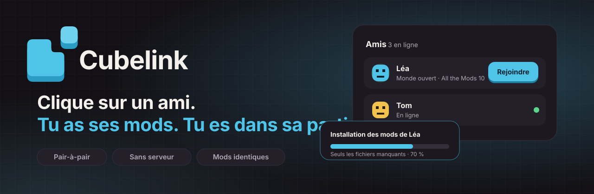
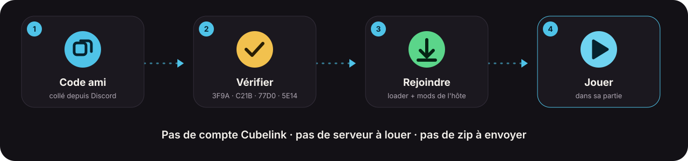
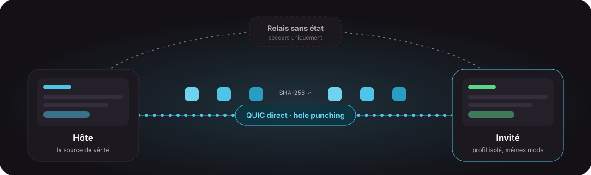

<div align="center">



[](https://github.com/delikesance/cubelink/actions/workflows/ci.yml)
[](LICENSE)


[Télécharger](https://github.com/delikesance/cubelink/releases/latest) · [Architecture](docs/architecture.md) · [Contribuer](#contribuer) · [Signaler un bug](https://github.com/delikesance/cubelink/issues)

</div>

---

## Pourquoi Cubelink ?

Jouer à un modpack avec des amis, c'est souvent la même galère : « t'as quelle version de Forge ? », « il te manque trois mods », « envoie-moi le zip de la config ». Les lanceurs existants (Prism, Modrinth App, CurseForge App) sont excellents pour *gérer* ses instances, mais aucun ne répond à la vraie question : **comment je rejoins la partie de mon pote, maintenant ?**

Avec Cubelink :

1. Ton ami t'envoie son **code ami** (une courte chaîne, sans secret : tu peux le coller sur Discord).
2. Tu l'ajoutes, vous comparez un **code de vérification** à l'oral.
3. Il ouvre son monde. Tu vois l'invitation, tu cliques sur **Rejoindre**.
4. Cubelink installe le bon loader et **les mods exacts de l'hôte**, puis te lance dans sa partie.

Pas de compte Cubelink, pas de serveur à louer, pas de téléchargement manuel.



## Ce que ça fait

| | |
|---|---|
| **Rejoindre en un clic** | Le profil invité est isolé de tes instances : le bon loader, la bonne version de Java, les mods de l'hôte (configs, `kubejs/` et `defaultconfigs/` compris). Seuls les fichiers qui te manquent sont transférés, par morceaux vérifiés par hash (SHA-256). |
| **Pair-à-pair** | Connexions QUIC directes entre amis ([Iroh](https://www.iroh.computer/)), avec hole punching. Un relais sans état n'intervient qu'en dernier recours. |
| **Modpacks et mods** | Parcourir Modrinth et CurseForge, installer un modpack, importer un `.mrpack`, activer, retirer ou ajouter des mods à une instance. |
| **Cache par hash** | Un fichier n'est téléchargé qu'une seule fois, puis partagé entre les instances par lien physique. |
| **Compte Microsoft** | Connexion directe entre ton appareil et Microsoft : Cubelink ne voit jamais ton mot de passe. Plusieurs comptes possibles. |
| **Jeu intégré (« la Scène »)** | Sous Windows, le jeu s'affiche *dans* la fenêtre du lanceur, avec un rideau de chargement et un panneau d'invitations en jeu. |
| **Sécurité lisible** | Rejoindre un ami revient à exécuter son code : l'écran de confirmation liste ce qui sera installé, et les mods inconnus des catalogues sont signalés. |
| **Mises à jour automatiques** | Via GitHub Releases, signature vérifiée. |

> **Vie privée** : pas d'analytics, pas de publicité, pas de serveur qui collecte tes données. Tout reste sur ta machine. Détails dans [`docs/privacy.md`](docs/privacy.md).

## Installer

| Plateforme | État | Comment |
|---|---|---|
| **Windows 10/11** | Plateforme principale | Paquet MSIX du **Microsoft Store** (signé par Microsoft, sans alerte SmartScreen), ou `.msi` sur les [releases](https://github.com/delikesance/cubelink/releases/latest) |
| **Linux** | AppImage construite en CI, **pas encore éprouvée sur une vraie machine** | [Releases](https://github.com/delikesance/cubelink/releases/latest) — les retours sont très bienvenus |
| **macOS** | Non pris en charge pour l'instant | — |

Détails du flux de release : [`docs/release.md`](docs/release.md).

## Comment ça marche



Chaque lanceur embarque un nœud P2P, un store de blobs adressé par hash, une base SQLite locale (amis, index du cache) et un tunnel QUIC ↔ `localhost` pour que Minecraft se connecte au monde de l'hôte ouvert en LAN. L'identité d'un joueur est une paire de clés ed25519 générée au premier lancement.

Le principe central : **la source de vérité, ce sont les fichiers de l'hôte**. Les catalogues servent à construire sa propre instance, pas à rejoindre un ami. Les versions sont donc strictement identiques, même pour un mod que l'hôte a lui-même créé.

Pour aller plus loin : [`docs/architecture.md`](docs/architecture.md) (décisions et protocole d'ajout d'ami), [`docs/contrats.md`](docs/contrats.md) (commandes et événements Tauri).

## Organisation du dépôt

| Dossier | Contenu |
|---|---|
| `core/` (`cubelink-core`) | Logique du jeu : auth Microsoft/Xbox/Minecraft, manifestes Mojang, Java, loaders (Fabric, Quilt, Forge, NeoForge), cache, Modrinth/CurseForge, import `.mrpack`, profil invité. Contient aussi l'**agent LAN** Java (`core/resources/lan-agent/`). |
| `p2p/` (`cubelink-p2p`) | Réseau : identité, code ami, présence, transfert par hash, tunnel de jeu, relais (Iroh/QUIC). |
| `host/` (`cubelink-host`) | « La Scène » sous Windows : adoption de la fenêtre du jeu, rideau, repli. |
| `src-tauri/` (`cubelink`) | L'application Tauri : commandes, intégration, mises à jour. |
| `src/` | Interface React/TypeScript : écrans (`screens/`), composants (`ui/`), services, tokens de design (`styles/`). |
| `e2e/` | Scénarios Playwright de bout en bout. |
| `docs/` | Architecture, contrats, guide UX, release, vie privée. |

## Lancer le projet en local

### Prérequis

- [Rust](https://rustup.rs/) (stable) et [Node.js](https://nodejs.org/) 22
- Les [prérequis système de Tauri 2](https://tauri.app/start/prerequisites/) (WebView2 et Build Tools C++ sous Windows)
- Un **JDK 17**, pour compiler l'agent LAN (`core/resources/cubelink-lan-agent.jar`, non versionné)

### Démarrer

```bash
git clone https://github.com/delikesance/cubelink.git
cd cubelink
git switch development

npm ci
JAVA_HOME=/chemin/vers/jdk17 bash core/resources/lan-agent/build.sh   # une fois, produit l'agent LAN
npx tauri dev                                                          # lanceur + front avec rechargement à chaud
```

Le premier build Rust est long (plusieurs minutes) et le dossier `target/` peut devenir volumineux : prévois de la place disque.

### Vérifier son travail

Du moins cher au plus cher, comme le fait la CI :

```bash
# Rapide, pendant qu'on code
cargo test -p cubelink-core --lib        # ou -p cubelink-p2p, -p cubelink, -p cubelink-host
npx tsc --noEmit
npx vitest run src/chemin/du/fichier.test.tsx

# Une fois, avant d'ouvrir la PR (c'est ce que lance la CI)
cargo clippy --workspace --all-targets -- -D warnings
cargo test --workspace
npx vitest run
```

Les scénarios Playwright (`npm run e2e`) et les tests Win32 de `host/tests/` ouvrent de vraies fenêtres : lance-les volontairement, un seul à la fois.

## Contribuer

Cubelink est un projet jeune, ouvert, et il y a de la place pour tout le monde : code Rust ou React, tests sur ta machine, doc, design, idées. Tu n'as pas besoin de connaître Iroh ou Tauri pour commencer.

### Par où commencer

- **Tester et rapporter** : lance Cubelink avec un ami, sur ta config, et ouvre une [issue](https://github.com/delikesance/cubelink/issues) avec ce qui s'est passé (OS, modpack, logs de l'app). Un test réel sur **Linux** est particulièrement utile aujourd'hui.
- **Modpacks et loaders** : un modpack qui ne se lance pas ou ne se synchronise pas est un bon terrain de jeu (`core/src/loader/`, `core/src/guest.rs`).
- **Catalogues** : vérifier et compléter la couverture CurseForge (`core/src/providers/`).
- **Interface** : états vides, messages d'erreur en langage courant, accessibilité. Le guide [`docs/ux-guidelines.md`](docs/ux-guidelines.md) liste les principes appliqués.
- **Documentation** : traduction en anglais, captures d'écran, tutoriels.
- **Réseau** : robustesse du hole punching, du transfert et de la reconnexion (`p2p/`). Lis d'abord [`docs/architecture.md`](docs/architecture.md), §3 et §4.

Pas sûr que ton idée rentre dans le projet ? Ouvre une issue pour en discuter avant de coder : c'est plus rapide pour tout le monde.

### Le flux, en quatre étapes

1. **Une branche par sujet**, depuis `development` : `git fetch && git switch -c <type>/<sujet-court> origin/development`. Types : `feat`, `fix`, `chore`, `docs`, `refactor`.
2. **Reste ciblé** : un changement = un sujet. Teste en local avec les commandes ci-dessus, puis lance une fois clippy, `cargo test --workspace` et `npx vitest run`.
3. **Ouvre une pull request vers `development`** (jamais directement vers `main`). Titre et description **en français** : ce qui change, comment c'est vérifié, ce qui reste à faire.
4. **Relecture et fusion** par le mainteneur. Pas de push forcé. `development` est fusionné dans `main` par le mainteneur au moment d'une release.

### Règles de la maison

- **Pas de logique sans test** : un correctif de bug vient avec le test qui l'aurait attrapé. La CI exécute clippy en `-D warnings`, les tests Rust (Windows), `tsc`, vitest et un `cargo check` Linux.
- **Pas de réseau réel dans les tests** : Microsoft, Mojang et Modrinth sont simulés ; le P2P se teste entre deux nœuds locaux.
- **Pas d'entrée réelle non plus** : un test ne pilote jamais la vraie souris, le vrai clavier ou le focus de ta machine ; on simule dans l'application.
- **Touche peu aux fichiers partagés** (`Cargo.toml`, `Cargo.lock`, `package.json`, `core/src/types.rs`, `docs/contrats.md`) et mentionne-le dans la PR si tu le fais : ce sont eux qui créent des conflits.
- **Vocabulaire sans jargon dans l'interface** : le joueur n'a pas à savoir ce qu'est un manifeste, un hash ou un relais.
- **Sécurité d'abord** : tout ce qui touche à l'authentification, au transfert de fichiers entre amis ou à l'exécution du code d'un ami est relu avec une attention particulière. Pour une faille, évite de publier les détails d'exploitation dans une issue publique : contacte d'abord le mainteneur.

### Contribuer avec Claude Code

Le dépôt est prêt pour les agents : [`CLAUDE.md`](CLAUDE.md) décrit le flux git, la boucle de vérification et les agents dédiés (`.claude/agents/`). Les règles ci-dessus s'appliquent de la même façon à une contribution assistée par IA : relis ce que tu soumets, et dis-le dans la PR.

## Feuille de route

- [x] Lancement solo, comptes Microsoft, loaders, cache par hash
- [x] Modrinth, import de modpacks, parcours du catalogue
- [x] Social P2P : code ami, présence, transfert, profil invité, tunnel de jeu
- [x] Refonte de l'interface, distribution via le Microsoft Store
- [x] La Scène : le jeu dans la fenêtre du lanceur (Windows)
- [ ] Essai réel à deux machines distantes, pour valider le jeu à plusieurs de bout en bout
- [ ] Relais auto-hébergé et plafonné (aujourd'hui : relais publics d'Iroh)
- [ ] Validation de la version Linux
- [ ] Découverte publique optionnelle des amis (décision de confidentialité à prendre)

L'état détaillé vit dans [`plan.md`](plan.md) et [`docs/architecture.md`](docs/architecture.md).

## Licence

[MIT](LICENSE) © 2026 Angelo Clauin. Minecraft est une marque de Mojang AB / Microsoft ; Cubelink n'est pas affilié à Mojang ni à Microsoft.
